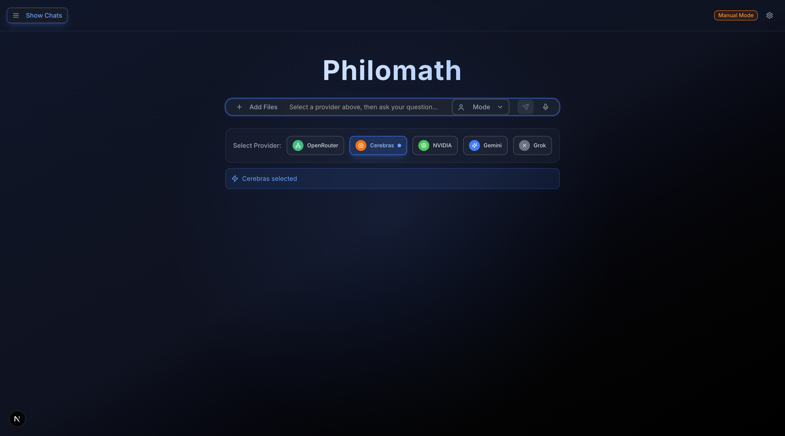
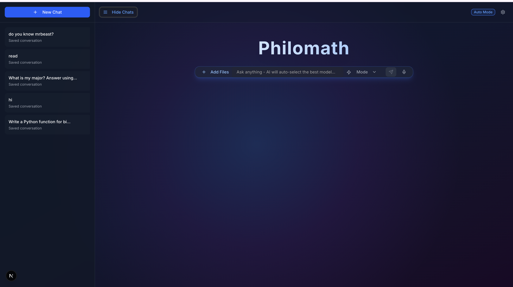

# Philomath

**A full-stack, multi-provider AI workspace with Bring Your Own Key (BYOK).**

Philomath brings multiple AI providers, conversations, and document context into a single application. Users sign in with Google, connect their own provider API keys, and choose how an answer is generated.

**[Open the live app](https://philomath-umber.vercel.app/)** · **[Review the Batch 5 release candidate](https://github.com/sujaljani1310-beep/Philomath/tree/philomath-batch5-checkpoint)**

> **Release status (November 2026):** The existing app is deployed from `main`. The separately developed Codex hardening work is in `philomath-batch5-checkpoint` and has passed extensive *offline and synthetic* validation. Its independent code-review verdict is **ready for staging**, **not yet approved for production**. The hardened code has **not been merged into `main`**. See [release gates](https://github.com/sujaljani1310-beep/Philomath/blob/philomath-batch5-checkpoint/backend/RELEASE.md).

## Screenshots

| Basic mode | Manual mode | Auto mode |
| --- | --- | --- |
|  |  |  |



## Features

- **Three chat modes:** **Basic** uses an ordered provider fallback; **Manual** uses a provider selected by the user; **Auto** uses task-aware capability scoring and the user's available integrations. Auto's scores are heuristic, not live provider benchmarks.
- **Five provider integrations:** Google Gemini, OpenRouter, Cerebras, NVIDIA and xAI Grok, subject to the user's own accounts, keys and available models.
- **Per-user BYOK:** Provider credentials are encrypted by the FastAPI backend before database storage. Browser responses use provider metadata rather than returning stored secrets.
- **Google sign-in:** Supabase authentication and user-scoped integrations, conversations and messages.
- **Conversation history:** Persisted threads with reload and conversation management.
- **Document context:** Multi-file uploads and extracted text used as context for chat.
- **Responsive workspace:** Next.js, React, TypeScript and Tailwind CSS.

## Architecture

```text
Browser — Next.js / React (Vercel)
   |  Google OAuth (Supabase Auth)
   |  Authenticated API requests
   v
FastAPI / Python (Render)
   |-- Auth + user-scoped conversation/integration services --> Supabase / PostgreSQL
   |-- Encrypted BYOK credentials
   |-- Basic / Manual / Auto routing -----------------------> AI providers
   `-- Document extraction and context handling
```

**Stack:** Next.js · React · TypeScript · Tailwind CSS · FastAPI · Python · Supabase · PostgreSQL · Vercel · Render.

## Hardening work with Codex — Batches 1–5

The release-candidate branch contains security, reliability, correctness and performance work that is **not necessarily present in the currently deployed `main` application**:

| Batch | Changes made |
| --- | --- |
| **1 — Routing and transport** | Safer redirects and request handling, bounded provider transport behavior, asynchronous/nonblocking diagnostics, and reproducible dependency constraints. |
| **2 — Resource protection** | Upload/body limits, bounded document extraction and worker resources, request admission and per-user rate/concurrency controls, provider input/output limits, and startup deadlines. |
| **3 — Persistence correctness** | Owner-filtered mutations, verified write acknowledgments, atomic integration upsert, safer handling of uncertain database results, and prevention of provider regeneration after an accepted answer fails to save. |
| **4 — Database isolation** | Reviewed RLS/grant and parent-ownership hardening candidates, guarded staging verification tooling and real *local* PostgreSQL regressions. Candidate SQL remains under `supabase/drafts/`; it is **not automatically deployed**. |
| **5 — Frontend and release validation** | Fixed unsaved-chat history request loops and stale account/history callbacks, corrected narrow Auto Mode routing and Grok model metadata, sanitized unexpected chat errors, and added synthetic end-to-end workflows and release/rollback documentation. |

**Security limits:** Encryption and application-side owner checks do not alone prove hosted database isolation. Database migrations, production grants, OAuth settings and real provider credentials require separately reviewed environment-specific validation. No claim of zero vulnerabilities or exactly-once message delivery is made.

### Recorded verification

The following results are from the preserved Codex validation reports, **not a fresh test run performed by this README update**:

| Check | Recorded result | Scope |
| --- | --- | --- |
| Batch 5 offline Python regression suite | **363 passed; 0 failed/skipped** | Network-blocked, synthetic peers using the installed SDKs |
| Batch 5 frontend callback tests | **25 passed; 0 failed/skipped** | Actual TypeScript callbacks exercised with Node |
| Batch 5 browser workflows | **Passed** | Chromium, synthetic OAuth/API/provider fixtures; offline font fixture |
| Batch 5 TypeScript check | **Passed** | Separate `tsc --noEmit --incremental false` |
| Batch 5 API compatibility | **Passed** | Canonical OpenAPI unchanged from approved baseline (7 paths, 5 schemas) |
| Batch 4 local PostgreSQL suite | **35 passed** | Real PostgreSQL 17.6 in an isolated container with synthetic Auth roles |
| Dependency integrity | **`pip check` passed** | Tested Python/Linux dependency environment |

The Batch 5 independent reviewer reported **ready for staging** after rerunning the Python and Node tests. Hosted Batch 4 success was separately reported by the project owner, but was not independently reproduced during Batch 5. No real Google OAuth/provider calls, production migrations, or production load tests are established by the recorded Batch 5 results.

Detailed evidence:
[Batch 4 review](https://github.com/sujaljani1310-beep/Philomath/blob/philomath-batch5-checkpoint/backend/BATCH4.md) ·
[Batch 4 test evidence](https://github.com/sujaljani1310-beep/Philomath/blob/philomath-batch5-checkpoint/backend/tests/postgres/VALIDATION.md) ·
[Batch 5 results](https://github.com/sujaljani1310-beep/Philomath/blob/philomath-batch5-checkpoint/backend/BATCH5.md) ·
[Release checklist](https://github.com/sujaljani1310-beep/Philomath/blob/philomath-batch5-checkpoint/backend/RELEASE.md).

## Run locally

**Prerequisites:** Python 3.12, Node.js/npm, a configured Supabase project with Google OAuth, and whichever provider accounts/API keys you plan to use. The hardening branch's pinned Python dependency set was validated on **CPython 3.12 / Linux x86_64**; other platforms, including macOS, need their own compatibility verification.

```bash
git clone https://github.com/sujaljani1310-beep/Philomath.git
cd Philomath

# To inspect the complete tested hardening candidate instead of main:
# git switch philomath-batch5-checkpoint

python3 -m venv backend/.venv
backend/.venv/bin/python -m pip install -r backend/requirements.txt

cd frontend
npm ci
cd ..
```

Configure the backend using `backend/env.example`, creating a **private** `backend/.env`:

```dotenv
SUPABASE_URL=https://YOUR_PROJECT.supabase.co
SUPABASE_SERVICE_ROLE_KEY=YOUR_SERVER_ONLY_SERVICE_ROLE_KEY
PHILOMATH_ENCRYPTION_KEY=YOUR_STABLE_FERNET_KEY
FRONTEND_ORIGINS=http://localhost:3000,http://127.0.0.1:3000
```

Generate a Fernet key once if this is a fresh environment; preserve the existing key for an environment with previously encrypted integrations:

```bash
backend/.venv/bin/python -c "from cryptography.fernet import Fernet; print(Fernet.generate_key().decode())"
```

Configure `frontend/.env.local` using `frontend/env.example`:

```dotenv
NEXT_PUBLIC_SUPABASE_URL=https://YOUR_PROJECT.supabase.co
NEXT_PUBLIC_SUPABASE_PUBLISHABLE_KEY=YOUR_PUBLIC_BROWSER_KEY
NEXT_PUBLIC_BACKEND_URL=http://127.0.0.1:8000
```

Set up the initial application schema and Google OAuth redirect settings only in an **authorized development project**, following [BYOK setup instructions](PHILOMATH_BYOK_SETUP.md). Do not blindly run the Batch 4 draft migrations against an existing or production database.

Start both services from the project root:

```bash
bash start.sh
```

Frontend: `http://localhost:3000` · Backend: `http://127.0.0.1:8000`

**Never** put Supabase service-role secrets, Fernet keys, provider API keys, database passwords, or private records in Git, a browser-exposed `NEXT_PUBLIC_*` variable, or logs.

## Testing the hardening candidate

On `philomath-batch5-checkpoint`, after installing the supported dependencies, run:

```bash
cd backend
PYTHONDONTWRITEBYTECODE=1 .venv/bin/python -B -m tests.run_offline
.venv/bin/python -B -m pip check
cd ..
node --test backend/scripts/test_frontend_loading.cjs
```

The Python runner deliberately disables credentials and blocks outbound sockets. For the isolated PostgreSQL tests and synthetic Chromium workflows, see the [Batch 4 database test guide](https://github.com/sujaljani1310-beep/Philomath/blob/philomath-batch5-checkpoint/backend/tests/postgres/README.md) and [Batch 5 reproduction steps](https://github.com/sujaljani1310-beep/Philomath/blob/philomath-batch5-checkpoint/backend/BATCH5.md). Those checks require additional local tooling; their reported results are not a substitute for hosted staging validation.

## Deployment and remaining release gates

The existing deployment uses **Vercel for the frontend** and **Render for the FastAPI backend**, with **Supabase for Auth and PostgreSQL**. The separate hardening branch should **not** be merged, migrated or promoted solely because offline tests passed.

Before a production hardening release:

1. Validate Google OAuth, account changes, all five real provider integrations, BYOK lifecycle, uploads and failure/recovery paths in isolated staging.
2. Review hosted RLS/permissions, parent ownership, actual production schema differences and guarded database migration effects, including legacy data.
3. Measure platform cold starts, real API/provider latency, memory under load and safe concurrency; agree on a total generation-latency policy.
4. Review secret rotation and configuration, compatible rollback artifacts, database recovery and monitoring; approve deployment separately.

**Known limitations:** Rate limits are process-local; cross-request database saves are not atomic or exactly-once; a failed response can follow a committed write; provider timeouts are inactivity limits rather than one total chat deadline; Render cold starts remain possible; Auto Mode capability scores are manually assigned heuristics.

## Why I built it

Philomath explores how independent AI providers can be brought into one user-owned workspace while building practical experience in full-stack architecture, REST APIs, authentication, encrypted credentials, databases, testing, operational safety and cloud deployment.

**Author:** Sujal Jani — Computer Science student interested in software engineering and AI systems.
